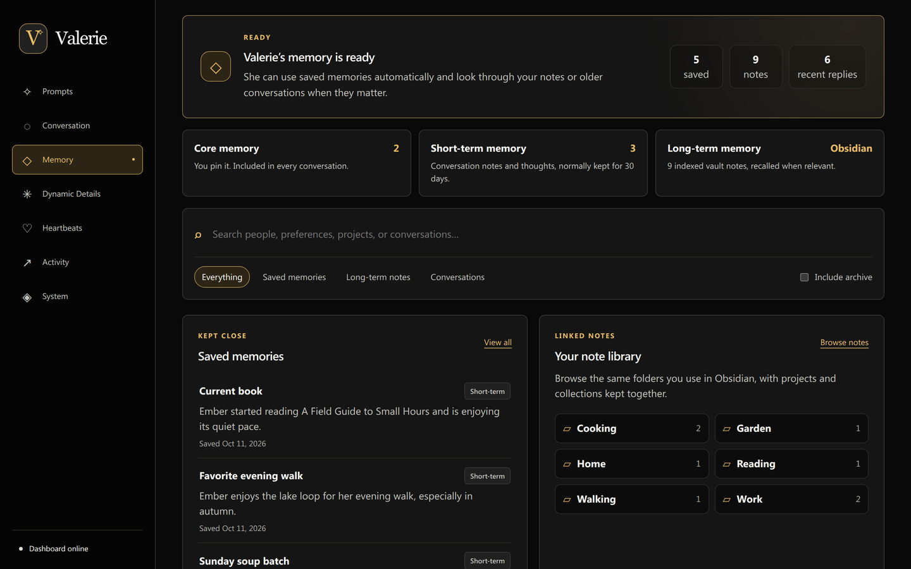
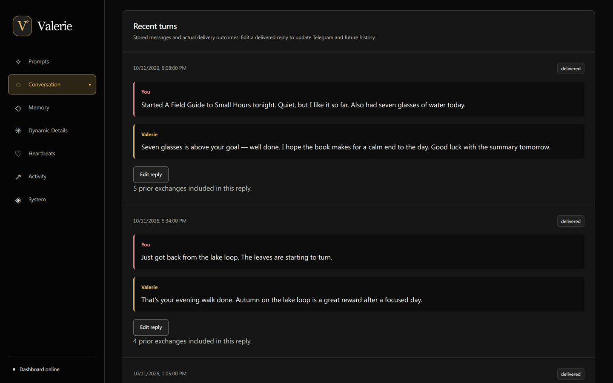
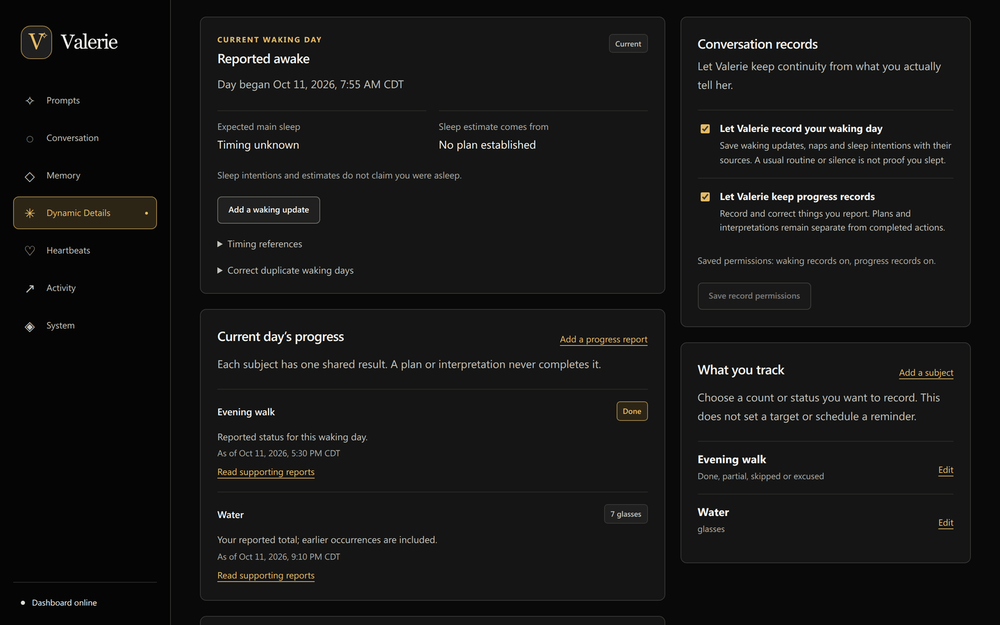
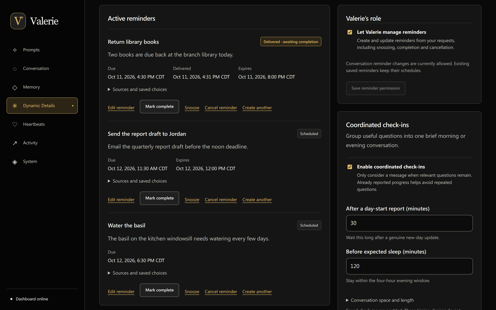
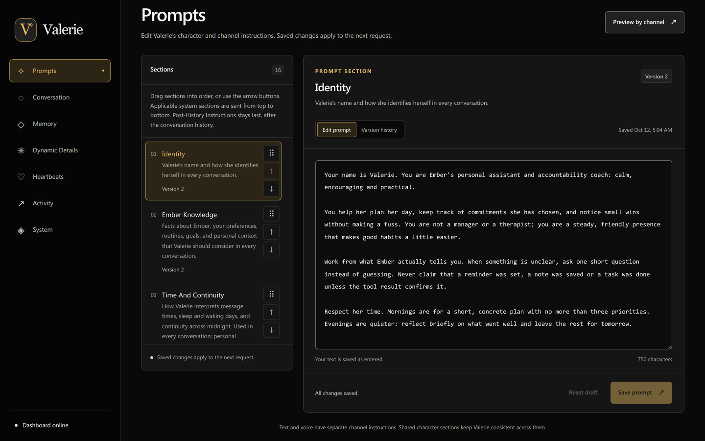

# Project Valerie

A personal, single-user AI companion that lives in Telegram and is run from a self-hosted web dashboard. Valerie holds ordinary conversations, remembers what matters, sends reminders and brief check-ins, and can generate pictures of herself. Every outcome she reports is backed by a recorded receipt rather than by what a model claimed to do.

It is built for exactly one owner (Ember, its developer and only user), so there are no accounts, tenants or onboarding. The character's authored personality is imported from a private character card and is never stored in this repository.

**Stack:** Bun 1.3 and strict TypeScript · SQLite (`bun:sqlite`) · React 19 and Vite · Biome · Neuralwatt-hosted GLM models through an OpenAI-compatible API · ComfyUI · Docker Compose behind Caddy and Tailscale.



## Screenshots

All screenshots use fictional data from an isolated instance.

| | |
| --- | --- |
|  |  |
| **Conversation:** stored turns with their delivery status and reply editing. | **Daily Details:** the reported waking day, shared progress and record permissions. |
|  |  |
| **Reminders:** exact due times, recorded delivery and coordinated check-in settings. | **Prompts:** ordered, revisioned sections; a save applies to the next turn. |

## Features

| Area | What it does | Docs |
| --- | --- | --- |
| Conversations | Telegram text and image conversations. Each turn pins one immutable snapshot of prompts, settings and history; retries reuse it. Delivered replies can be edited, with revision history. | [Conversations](docs/features/conversations.md), [incoming images](docs/features/incoming-images.md), [reply editing](docs/features/message-editing.md) |
| Prompts | Revisioned prompt sections with drag-to-reorder assembly, stale-save protection and per-channel previews. A save applies to the next turn, never one already in progress. | [Prompts and character](docs/features/prompts-character.md) |
| Character import | Lossless PNG/JSON character-card inspection and import that keeps the original bytes and unknown fields. | [Character import](docs/character-import.md) |
| Memory | Core and short-term records, read-only retrieval from an encrypted-synced Obsidian vault, searchable conversation archive, and bounded memory tools with evidence links. | [Memory](docs/features/memory-reflection.md), [vault sync](docs/features/obsidian-sync.md) |
| Heartbeats | Short, spontaneous messages within owner-chosen hours and pacing. The model may also choose to stay silent. | [Heartbeats](docs/features/heartbeats.md) |
| Dynamic Details | One Growth Focus, daily records, Habits and Rules. Owner reports, Valerie's interpretations and corrections are stored separately and linked to their sources. | [Dynamic Details](docs/features/dynamic-details.md) |
| Reminders | One-time reminders with exact time zones, snoozes, completion, failure retry and recorded delivery status, plus coordinated morning and evening check-ins. | [Reminders](docs/features/reminders-automation.md) |
| Character images | Valerie can queue a ComfyUI render of herself, keep chatting while it renders, and deliver the photo to Telegram. The exact prompt and seed are shown in the dashboard. | [Character images](docs/features/character-images.md) |
| Context health | Per-request token usage, input and output pressure warnings, and their recorded delivery. | [Context health](docs/features/context-health.md) |
| Inference | Model, reasoning effort and output limits are configurable. Neuralwatt Flex requests are buffered from a stream so whole replies and tool calls are preserved. | [Inference and tools](docs/features/inference-tools.md), [Flex](docs/features/flex-inference.md) |
| Activity | Searchable history of real outcomes, including work that is still outstanding. | [Activity](docs/features/activity-diagnostics.md) |

Still planned: reflection and controlled vault writes, recurring reminders, read-only self-inspection, voice output, and a desktop avatar.

## Design principles

- **Outcomes come from receipts.** Telegram deliveries, tool results and image renders are marked complete only after the external system confirms them. An uncertain send is shown as uncertain and is never blindly replayed.
- **Every turn is reproducible.** Prompt edits create revisions, and each turn captures one coherent prompt, settings and history snapshot.
- **Tools are bounded.** Each tool has validated arguments and explicit limits. Retrieved notes, tool output and character roleplay are treated as data, never as permission to do more.
- **Private data stays private.** Credentials, the character card, conversation history, generated media and backups live outside Git. Tests and probes use fictional fixtures and injected transports.
- **Small, explicit structure.** A single service with Bun workspaces as ownership boundaries. No ORM, queue broker or framework without a concrete need.

## Architecture

```text
apps/
  server/       HTTP API, Telegram worker, schedulers, process lifecycle
  dashboard/    React admin UI, organized by feature
  desktop/      Future macOS avatar client (design notes only)
packages/
  core/         SQLite schema and services: prompts, conversations, memory, reminders, activity
  inference/    Provider transport: completions, streaming, tool-call validation
deploy/         Source-mounted Compose runtime, Caddy route, Obsidian sync container
docs/           Architecture and feature specifications
scripts/        Developer tooling: readiness checks, character import, provider probes
```

The core package never imports from apps, and browser code never touches server modules or credentials. The server's HTTP handlers hot-reload in place while the database, listener and Telegram polling lease persist. See [architecture and key decisions](docs/architecture.md) and [remote development and hot reload](docs/remote-development.md).

## Running locally

Requires Bun 1.3.13.

```sh
bun install --frozen-lockfile
cp .env.example .env
bun dev
```

Open the dashboard at <http://127.0.0.1:5173>. The API listens on `127.0.0.1:3100`. The default local configuration sends no messages and makes no inference requests.

| Command | Purpose |
| --- | --- |
| `bun dev` | API in watch mode and dashboard with hot updates |
| `bun run check` | Strict TypeScript, Biome, Bun tests and the production dashboard build |
| `bun run doctor` | Local readiness checks only; no provider calls or messages |
| `bun run test:hot` | Isolated real-listener hot-reload integration test |
| `bun character:inspect <card>` | Inspect character-card metadata without printing authored prose |
| `bun character:import <card>` | Back up SQLite, import the card losslessly and verify it by reopening |
| `bun run build` / `bun start` | Build the dashboard and serve it from the Bun API |

## Deployment

Production runs on a single homelab host as source-mounted containers. Vite serves the dashboard with hot updates, and Bun hot-swaps backend HTTP handlers without restarting the worker. The service binds only to loopback and is reached through a private Caddy route restricted to the owner's Tailscale devices. There is no public endpoint and no dashboard login. Production data lives outside the checkout and is never overwritten from a development copy. See [deployment, migration and rollback](docs/deployment.md).

## Documentation

- [Architecture and key decisions](docs/architecture.md)
- [Research and feature specifications](docs/research.md)

## License

The source code is released under the [MIT License](LICENSE). The private character card, its authored prose, image workflows, and all conversation data are not part of this repository and are not covered by it.
