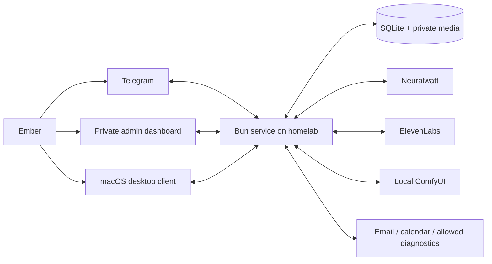

# Architecture

Decision date: September 11, 2026. Owner: Ember. Product: one private character, Valerie. Desktop target: macOS first. This document describes the intended system.

## Product contract

Ember is the only developer and user. This is personal software, not a product intended for distribution. The dashboard contains practical controls and factual status; it does not need accounts, onboarding, workspace selection, decorative product copy, or a separate dashboard token. Reuse and generalization must serve an actual need in this deployment.

Valerie is an immersive companion with a user-authored supportive coaching relationship for tasks, habits, and positive motivation. Preserve the character's personality, speech patterns, and relationship text verbatim. Interaction style must not become a substitute for accurate tool results or user control. Character prompts can shape phrasing; executable policy and the user's actual requests determine permitted actions.

Text and voice share conversational meaning but have different presentation. Telegram text can contain authored `*actions*`; spoken output is composed with a voice-specific prompt and contains only intended speech. Emotion and animation are structured side channels rather than tags leaked into messages. Routine actions should not generate button panels, progress chatter, or fake typing stage directions.

## Why this structure

Use a **Bun workspace monorepo with a modular monolith**. The canonical source now lives on homelab. One Bun process owns the API and domain services; a separate Vite process provides live dashboard updates during active development through the same private production hostname. Both use a stable runtime image and source mounts, so routine edits do not rebuild images. The API can still serve a static dashboard build when chosen. Future Telegram/job lifecycles require explicit owners. A future Electron desktop application runs on the Mac and connects privately to homelab.

React is appropriate for the dashboard even though the server is not a React project. Feature folders retain the useful parts of Bulletproof React without importing an entire template. Bun provides the runtime, package manager, test runner, and SQLite driver. The current API uses Hono for routing/middleware. Avoid Redis, Kafka, microservices, vector infrastructure, and a generic agent framework until a measured need appears.

[Bun workspaces](https://bun.com/docs/pm/workspaces) support these package boundaries. [Bun SQLite](https://bun.com/docs/runtime/sqlite) provides prepared statements and transactions without a separate database service. This is a suitability decision for a single-user deployment, not a throughput claim.

## Ownership and dependency direction

| Boundary | Responsibility | Does not own |
| --- | --- | --- |
| Server | Private request boundaries, routing, startup/shutdown, scheduling adapters | Character prose or provider-specific parsing |
| Core features | Domain state and invariants: prompts, memory, reminders, jobs, activity | HTTP, React, raw provider transport |
| Inference | Neuralwatt requests, cancellation, usage, typed results | Tool authorization, scheduling, sending replies |
| Dashboard | Editing, previews, history, health and management views | Credentials, direct database access |
| Desktop | Window behavior, rendering, animation, audio playback | Background reminder authority or provider keys |
| Resources | Workflow templates, mappings, licenses | Mutable runtime configuration or secrets |

Apps import packages through their public exports. Core does not import apps. Keep schemas/types close to their owning feature; introduce a contracts package only when multiple clients need the same stable wire protocol. Provider integrations get a folder and a small interface first, a new package only when independently useful.

## Configuration without unnecessary restarts

| Change | Intended application point | Foundation status |
| --- | --- | --- |
| Prompt content | Atomic revision; next turn captures new snapshot | Implemented |
| Prompt order | Independent version; applicable sections follow saved order with title headings; after-history stays separate | Implemented |
| Character mapping / memory policies / routine settings | Validated database revision; next turn/job | Designed |
| Reminder snooze/completion/next due | Immediate transaction; scheduler observes committed row | Designed |
| ComfyUI workflow, expression maps, voice settings | Validate then activate version; pin in-flight job | Designed |
| Tool enablement or permissions | Policy revision; recheck before every side effect | Designed |
| API keys | Explicit provider-client rotation at safe boundary | Environment at startup initially |
| Code/dependencies | Drain active work, checkpoint state, controlled restart | Manual restart; watch mode for development |
| Database schema | Versioned migrations with backup and compatibility checks | Initial migrations implemented |

The implemented backend hot runtime explicitly owns one store, listener and shutdown pair while replacing request handlers. Failed construction preserves the previous handler; existing requests keep their captured handler. `bun --hot` alone does not make timers/pollers safe: future persistent resources require explicit disposal and lifecycle ownership. Schema/dependency/bootstrap changes still need a controlled restart. [Bun's watch documentation](https://bun.com/docs/runtime/watch-mode), [implemented reload boundaries](remote-development.md).

## Turn pipeline (next milestone)

1. Persist a Telegram/desktop input with transport ID and deduplication key.
2. Serialize conversation turns for this character; cancel stale background proposals when user input arrives.
3. Capture exact prompt/config revisions, current local time, compact recent conversation, current task/reminder pointers, and bounded memory index.
4. Call the configured Neuralwatt model with an explicit budget and tool set supported by that model.
5. Validate tool arguments and capability policy in code; execute bounded operations and append factual activity outcomes. Repeat within a total turn deadline and tool-call limit.
6. Produce channel output plus optional emotion and speech metadata. Do not let malformed metadata discard otherwise valid plain text.
7. Store outgoing message intent in a durable outbox. Send, then record the provider receipt. An ambiguous send remains unknown and is not blindly replayed.
8. Append concise completed/outstanding work summaries. Reflection later proposes memory changes from source-linked records.

The text milestone implements durable owner input, serialized generation, atomic prompt/settings/history snapshots, and a receipt-backed Telegram outbox. A bounded image tool now queues ComfyUI work independently and generates an acknowledgement in the character's voice; photo delivery uses immutable stored media and actual Telegram receipts. Bounded core/short memory, read-only vault retrieval, archived conversation and activity tools, and durable tool outcomes are implemented. Current reminder pointers and exact reply-target context are now implemented; external tools and reflection remain planned. See [implemented conversation behavior](features/conversations.md) and [character images](features/character-images.md).

## Persistence map

SQLite WAL on the homelab's local disk is the source of truth. Enable foreign keys, busy timeout, explicit transactions, and numbered migrations. Do not place the live database on SMB/NFS. Small initial migrations use direct SQL; introduce a query builder only if actual query complexity warrants it.

| Data | Intended authority and retention |
| --- | --- |
| Prompt blocks/revisions | Exact authored text and audit trail; explicit restore makes a new revision |
| Imported character source | Original bytes/hash/raw JSON retained separately from projection and Valerie display override |
| Messages and deliveries | Durable transport history with receipts; bounded context is only a view |
| Memory nodes/links/evidence | Core, short-term, long-term, learned-topic nodes; provenance, expiry, supersession and retrieval budgets |
| Obsidian vault | Canonical authored notes, long-term note prose and topic links; synchronized privately to homelab, with revisioned SQLite retrieval indexes |
| Reminders/occurrences | Purpose, timing, snooze, life cycle, outcome; never inferred from a copied memory |
| Jobs/runs/leases | Restart-safe recurring work and ownership; no process-local timer as sole authority |
| Activity/work items | Seven-day searchable detail, longer concise summaries, unresolved work retained until resolved |
| Metrics | Latency/errors/queue age/provider usage without secrets or message bodies |
| Private media | Files with IDs, MIME/size/hash, provenance and retention; no unrestricted file paths from a model |

Migration 005 adds versioned inference settings, conversation turns with immutable generation snapshots, a durable Telegram cursor/bot identity, an outbox, and a worker lease to the existing prompt, character and activity tables. See core source for exact schema. Migration 008 adds memory records/revisions, vault indexes and FTS5 conversation evidence; migration 009 journals tool rounds and outcomes. Reminder and autonomous-job tables remain design targets; requested image jobs are implemented in migration 007. Activity search remains literal substring search. Semantic vectors are optional later, combined with exact lookup and graph links, not a replacement for source ownership.

The 2026-09-14 memory storage decision makes vault prose authoritative in Markdown, with core/short-term state, evidence, imported revisions, audit history and retrieval indexes in SQLite. The independent [Obsidian sync service](features/obsidian-sync.md) is running, and its credentials are never mounted into Valerie's API. The API now receives only a read-only vault mount; lifecycle-owned scans reconcile approved notes before conversation startup and every 30 seconds. Memory and tool outcomes are pinned for reproducible turns and replay. Future reflection must journal and reconcile file writes before completing its SQLite cursor; it cannot treat a Markdown edit and a database commit as one atomic transaction. See [memory ownership and reflection](features/memory-reflection.md).

Migration 010 adds thought text to the memory FTS index without rewriting original memory records or revisions. Conversation-backed saves can paraphrase owner evidence from the current or earlier turns and retain separate interpretation, provenance and author metadata. The memory tool can update active short notes with optimistic version checks; core and vault writes remain outside its permissions.

Migrations 011 and 012 add persisted heartbeat settings/opportunities, fenced runs, immutable generation evidence, actual Telegram receipts and assistant-only archive entries. The existing Telegram lease owns concurrent heartbeat generation and serialized delivery; fresh owner input or changed settings suppress stale unsent work. Owner-configured anytime or overnight windows, independent caps, and unknown-send recovery preserve pacing across restart. Heartbeat snapshots use existing authored character prompts, core and sleep context, dated recent conversation, and a native-text-or-silence contract with no executable tools. See [heartbeat behavior](features/heartbeats.md).

Automatic recall now extracts at most 64 bounded lexical cues across the full incoming caption, filtering common conversational filler. It shares the explicit search path's active/available/archive filtering and keeps the established context budgets, while explicit tool search also supports empty-query browsing. Memory Use revision 3 supplies the evidence, personal attribution and natural acknowledgement guidance; no character or output-text rewrite is involved.

Migration 006 archives individual Telegram source messages, groups open image albums, and stores immutable downloaded image bytes and provenance. Snapshots reference asset IDs/hashes; the server materializes inline image data for the verified vision model. Inference context retains bounded recent images independently of the permanent archive. See [incoming image ownership and limits](features/incoming-images.md).

Migration 007 adds durable character-image requests, immutable generated image bytes, and separate failure-notice delivery records. Each source turn owns at most one render; canonical prompt IDs, workflow graphs, seeds and tool invocations are pinned before submission. The existing Telegram lease owns the concurrent render loop. Unknown submissions reconcile without another POST, and ambiguous photo sends are not replayed. Only the final workflow output and a Telegram receipt establish completion.

Back up SQLite with its online backup API or a stopped/quiescent checkpointed database; copying only the `.sqlite` file while WAL is active can omit committed data. Keep backups and secrets outside release directories. Exercise a restore into a temporary path before cutover.

Migrations 013–015 add Growth Focus and immutable source-backed progress notes, a per-invocation context ledger, and durable technical warning episodes. Model mutations intersect pinned and current owner delegation. Compact focus snapshots stay separate from retrieved detailed notes; state-only changes preserve description evidence. Technical warnings use the existing Telegram send loop and lease independently of casual pacing, with explicit recovery for definitive failures and no replay of uncertain sends. Model-quality calibration remains separate; Habits, Rules and one-time reminder delivery are described below.

Migration 016 adds reported waking days, source-claimed shared progress, revisioned corrections and bounded Telegram quote/forward metadata. Original text bytes remain unchanged; older transport provenance stays unknown. Three daily tools retain the existing 16-tool request limit, and immutable snapshot defaults preserve concurrency without requiring the model to repeat every known identifier. Reported day boundaries do not claim observed sleep. The reported-day windows now feed the coordinated reminder dispatcher.

## Separate time-driven systems

- Reminders are explicit commitments: independent per-record schedules and snoozes, durable next occurrence, and delivery state.
- Interval jobs run requested checks/scripts and record results; their output may or may not justify a message.
- Heartbeats are opportunities for casual conversation or silence, with quiet periods and a durable unanswered-message ceiling. They cannot reschedule reminders.
- Daily reflection quietly consolidates evidence, updates memory through validated tools, and creates feature suggestions for review. It cannot modify its own executable code, permission policy, or character prose.

Conversation snapshots now include local current/input times and separate historical exchange timestamps, counted in context budgets without altering authored message text. Revisioned Time And Continuity and Memory Use instructions are editable beside Ember Knowledge in the dashboard. The latest saved sleep routine and explicit updates supply context; a calendar rollover is not evidence of a new waking day or a missed meal. There is no automatic sleep-state inference.

Use UTC for storage and elapsed durations, timezone-aware calendar arithmetic for recurring local schedules, and America/Chicago for Ember-facing time. Test DST, clock changes, restarts, overdue work, and duplicate dispatch. Each run carries a stable identity and explicit status.

## Security and operational boundaries

The service accepts only loopback binding and has no separate dashboard login. The selected homelab endpoint is `valerie.loafykitten.cafe`, through the existing private Caddy/Tailscale sidecar with an explicit device allowlist. Its upstream must share that sidecar's network namespace; the host's loopback is separate. SSH remains an alternative private route. This authenticated network path is the authorization boundary, so a public proxy, Funnel, or broadly shared tailnet grant is unsuitable. Private-to-tailnet is not automatically private-to-Ember. [Access control](https://tailscale.com/docs/features/access-control/acls), [deployment details](deployment.md).

Keep exact origin/host checks, reject cross-site browser requests, preserve bounded request sizes/security headers, and keep provider secrets out of browser bundles. These checks limit unwanted browser requests; they do not replace network authorization. Existing nonempty dashboard-token configuration causes a startup error so migration cannot silently expose a previously token-protected instance. No homelab proxy or policy has been configured by this UI change.

Tools declare read/write/send capabilities, argument schemas, timeouts, result limits, and idempotency expectations. Reading logs is an allowlisted operation; arbitrary shell and Docker socket access are not default capabilities. Email content and web pages cannot grant permissions. Do not send email, invite attendees, run destructive scripts, or change production systems merely because a reflection suggested it.

Failures should name the failed action, a safe cause, and an actionable next step. Persist correlation IDs and measured timings, not raw provider errors containing URLs or credentials. Self-diagnostics can inspect metrics and propose remedies; actual recovery actions use the same tool policy as any other work.

## Alternatives and revisit points

- PostgreSQL becomes useful for multiple hosts/writers or demonstrated SQLite contention; it is extra operations today.
- Redis/dedicated queues become useful for many workers or heavy workloads; a leased SQLite dispatcher fits the first host.
- Tauri is lighter but macOS transparency requires private API configuration. Electron is the first VRM spike because transparent window and input controls are documented and its browser runtime is predictable. Validate Mac behavior before committing to packaging.
- A generic multi-provider framework adds abstractions before there is a second provider. Preserve a narrow completion contract, then add adapters as needed.
- Existing agent products inspire UX and behavior, but no framework is adopted wholesale. Character fidelity, hot prompt editing, reminder ownership, and the single-user service are easier to reason about in explicit modules.

Detailed acceptance criteria, provider sources, and unresolved account/platform assumptions live in the linked feature specifications.

Migrations 017–019 add Habits/Rules, shared-event opportunity projections, one-time reminders, fenced scheduled preparation/delivery journals, coordinated check-in slots and receipt-backed assistant archive entries. Ordinary generation, explicit preparation and optional preparation run independently with one Telegram lease and one actual send loop. Optional work checks day/source/agreement/prompt freshness; explicit commitments use their own timing and policy. New snapshots pin the 16-tool catalog, and every ordinary provider invocation retains its exact offered schemas. Legacy snapshot executors remain available only under their original catalog. Conditional reply-target context supplies an exact current task when an owner reply references its confirmed delivery.

Flex inference uses buffered SSE within the existing adapter and worker: complete output and tool validation precede use, bounded capacity waits preserve cancellation, and migration 021 adds immutable per-request tier/cost receipts without inferring historical billing. See [Flex ownership and verification](features/flex-inference.md).
